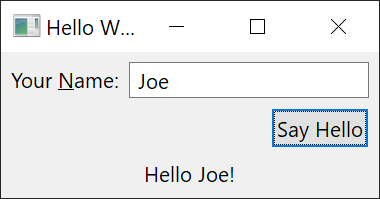

<!-- fork-homepage-detail:v1:start -->
# SWT: native desktop interfaces for Java

The Standard Widget Toolkit supplies Java widgets, events, layouts and graphics
backed by the host desktop platform. It powers Eclipse and can also be used by
standalone JVM applications. Start here for a native widget, event-loop, JNI or
resource-lifetime problem; use Platform UI for JFace viewers and workbench parts.

[Source map](#swt-source-map) · [Concepts](#swt-key-concepts) ·
[Quickstart](#swt-quickstart) · [Example](#swt-worked-example) ·
[Development guide](docs/DEVELOPMENT_GUIDE.md)

## SWT source map

| Area | What it owns |
| --- | --- |
| [Main SWT bundle](bundles/org.eclipse.swt/) | Shared APIs and platform-specific widget implementations |
| [Native development notes](bundles/org.eclipse.swt/Readme.md) | JNI and host-specific native build routes |
| [binaries/](binaries/) | OS/window-system/architecture-specific native fragments |
| [Snippets](examples/org.eclipse.swt.snippets/) | Small runnable API demonstrations and reproductions |
| [tests/](tests/) | Common tests and backend-specific test fragments |
| [SWT tools](bundles/org.eclipse.swt.tools/) | JNI generation and developer tooling |

The same widget name can have different GTK, Win32 and Cocoa implementations.
Find the actual host backend before explaining behavior from a source file.

## SWT key concepts

- **Display:** owns the UI event context and dispatch loop.
- **Shell / Control:** a top-level window and the base abstraction for controls.
- **Listener:** responds to a widget event; layout determines geometry separately.
- **UI-thread affinity:** widget operations normally belong on the owning display
  thread. `asyncExec` schedules UI work; it does not keep a control alive.
- **Native fragment / JNI:** matching platform libraries and the Java/native
  boundary. Java compilation alone does not prove the native library can load.
- **Owned / borrowed resource:** application-created `GC` and `Image` objects
  need cleanup; borrowed paint-event or framework-owned resources must not be
  disposed as though the application created them.

## SWT fork status

This is an experimental downstream fork of
[Eclipse SWT](https://github.com/eclipse-platform/eclipse.platform.swt).
The checkout contains SWT APIs/backends, fork-specific implementation work such
as [ItemBitSet](bundles/org.eclipse.swt/Eclipse%20SWT/common/org/eclipse/swt/internal/residency/ItemBitSet.java),
and [M3 recipe/inventory tooling](.m3/README.md). Source presence is not a claim
that every backend, default model or optimization is qualified. The
[development guide](docs/DEVELOPMENT_GUIDE.md) distinguishes native rendering,
visible-screen evidence, behavior tests and independent resource measurements.
Upstream releases and badges below describe their linked upstream projects.

## SWT quickstart

For application adoption, follow the original platform-specific JAR and Hello
World example below. For source development, the inspected
[matrix](.github/workflows/maven.yml) uses **Java 25** and the
[build workflow](.github/workflows/build.yml) selects **Maven 3.9.16**.
Install/configure Git LFS before cloning if using precompiled native binaries,
or follow the host-native build guide. You also need native dependencies and a
working display for GUI tests.

```sh
git clone https://github.com/hsoliwal/eclipse.platform.swt.git
cd eclipse.platform.swt
git rev-parse HEAD
git lfs ls-files
java -version
mvn -version
mvn clean verify
```

This is a source-checked build route, not a test receipt. LFS pointer files are
not usable native binaries, and packaging multiple fragments does not execute
tests on all of their platforms.

## SWT command and debugging cheat sheet

```sh
# Artifact-only build; does not establish test success.
mvn clean verify -DskipTests
# Native verification on a provisioned Linux x86_64 GTK host only.
mvn clean verify -Dnative=gtk.linux.x86_64
# Find the smallest event-loop reproductions.
git grep -n 'readAndDispatch' -- examples/org.eclipse.swt.snippets
```

- **Invalid thread access:** trace the caller and display ownership first.
- **Disposed widget in delayed work:** check liveness inside the dispatched
  callback and coordinate display shutdown with workers.
- **Native load failure:** check OS, CPU, resolved LFS objects and fragment match.
- **JNI changes:** use the documented generator, review its diff and build the
  matching native library. Do not hand-edit generated glue or commit local binaries.

## SWT worked example

**Open, resize and close a minimal window.** Read
[Snippet1.java](examples/org.eclipse.swt.snippets/src/org/eclipse/swt/snippets/Snippet1.java)
in a configured SWT workspace:

1. A standalone application creates its `Display` and a `Shell`.
2. `shell.open()` makes the window available for interaction.
3. `readAndDispatch()` processes events; `sleep()` waits when there are none.
4. Closing the shell ends the loop; the application disposes the display it owns.
5. Add the README's button/text example only after that lifecycle works. Keep
   listeners short and check repeated open/close behavior on the real backend.

The workbench owns its display, so a plug-in must not copy standalone teardown
blindly. This is an exploration to run, not evidence of a new native/UI test pass.
Continue with [the development guide](docs/DEVELOPMENT_GUIDE.md),
[Linux](bundles/org.eclipse.swt/Readme.Linux.md),
[Windows](bundles/org.eclipse.swt/Readme.Win32.md) or
[macOS](bundles/org.eclipse.swt/Readme.macOS.md) setup and
[CONTRIBUTING.md](CONTRIBUTING.md). Existing fork/upstream material follows.

> Source tour checked at [`9cc0683c4925`](https://github.com/hsoliwal/eclipse.platform.swt/tree/9cc0683c49255a23400ba491d86e1311e69447c0). Commands describe that revision; recheck build configuration when changing revisions. Build/UI/performance verification was not run for this README update.

---

<!-- fork-homepage-detail:v1:end -->

<div align="center">

## M³ × SWT

**Native desktop widgets are where runtime ideas meet real UI contracts.**

[](https://github.com/hsoliwal/M3jdk21)
[](https://github.com/hsoliwal/M3jdk21/blob/master/m3/release/BENCHMARK_AND_COMPATIBILITY_SPEC.md)

**[M3 runtime programme](https://github.com/hsoliwal/M3jdk21)** · **[Technical paper](https://github.com/hsoliwal/M3jdk21/blob/master/m3/papers/M3_SHARED_STRUCTURE_AND_REUSABLE_COMPUTATION.md)** · **[Source invitation](#come-inspect-the-code)**

</div>

> [!NOTE]
> **This is an experimental downstream fork of [the upstream SWT project](https://github.com/eclipse-platform/eclipse.platform.swt).** M3 String, regex, precompute and collection integration are **engineering directions**, not verified deployment, performance, compatibility or upstream-endorsement claims. Preserve original licensing, copyright, API behavior and native/UI contracts.

### Engineering questions for this fork

| Surface | What to investigate | Non-negotiable contract |
| --- | --- | --- |
| **Events and input** | Measure event-dispatch latency and repeated text work | UI-thread affinity and event ordering |
| **Native boundaries** | Study JNI/native transitions and canonical shared data | SWT platform behavior and resource lifecycle |
| **Widget resources** | Measure allocation, retained memory, disposal and steady-state responsiveness | No leaks, regressions or changed public APIs |

**Approach:** inventory first; copy/derive only with license and provenance; qualify reusable recipes in Synexia; port into the appropriate runtime/product owner; then test with representative desktop projects and publish CPU, allocation, retained-memory, startup and responsiveness numbers, including regressions. No Synexia runtime dependency.

### Come inspect the code

> **Java, JNI, SWT, workbenches, widgets, real code: open the repositories.** Bring a failing case, a performance counterexample, a profiler trace or a better algorithm. Challenge the design on the merits of source, tests and evidence—not slogans or a résumé.

**Explore the family:** [M3JDK21](https://github.com/hsoliwal/M3jdk21) · [SWT](https://github.com/hsoliwal/eclipse.platform.swt) · [Eclipse Platform](https://github.com/hsoliwal/eclipse.platform) · [Platform UI](https://github.com/hsoliwal/eclipse.platform.ui) · [Nebula](https://github.com/hsoliwal/nebula) · [GEF Classic](https://github.com/hsoliwal/gef-classic).

**Contribute here:** [issues](https://github.com/hsoliwal/eclipse.platform.swt/issues) · [pull requests](https://github.com/hsoliwal/eclipse.platform.swt/pulls) · [M3 compatibility and benchmark contract](https://github.com/hsoliwal/M3jdk21/blob/master/m3/release/BENCHMARK_AND_COMPATIBILITY_SPEC.md).

The remainder of this README retains the existing M3 fork notes and the **original upstream SWT documentation**. Nothing in this introduction rebrands upstream work as M3-authored code.

---

## M3 direction in this fork

M3 is based on the idea that shared immutable structure and indexed metadata can
provide a basis for reusable computation. The programme starts with M3 String,
regex, and precompute in M3JDK21, then collections and SWT/Eclipse integration.

This SWT fork is a target for exploring qualified runtime and collection improvements at the desktop toolkit boundary, with widget behavior, native integration, and responsiveness remaining central.

**Explore the idea:** [M3 technical design paper](https://github.com/hsoliwal/M3jdk21/blob/master/m3/papers/M3_SHARED_STRUCTURE_AND_REUSABLE_COMPUTATION.md) ·
[Programme goals and roadmap](https://github.com/hsoliwal/M3jdk21#project-goals-and-plan).
The paper explains the proposed architecture, cost tradeoffs, and evaluation plan.
Readers are invited to examine the work and contribute representative workloads.

This section describes the direction of the hsoliwal fork. Upstream documentation
follows below; upstream authorship, licenses, and project identity remain intact.

---

[](https://github.com/eclipse-platform/eclipse.platform.swt/actions/workflows/maven.yml)
[](https://github.com/eclipse-platform/eclipse.platform.swt/actions/workflows/junit.yml)
[](https://github.com/eclipse-platform/eclipse.platform.swt/blob/master/LICENSE)

# About

SWT is a cross-platform GUI library for JVM based desktop applications.
The best known SWT-based application is [Eclipse](https://www.eclipse.org).

For more information about SWT, visit the [official SWT page](https://eclipse.dev/eclipse/swt/).

## Getting Started

SWT comes with platform-specific jar files.
Download them from https://download.eclipse.org/eclipse/downloads and add the jar file to your classpath.

### Example

```java
import org.eclipse.swt.SWT;
import org.eclipse.swt.layout.GridData;
import org.eclipse.swt.layout.GridLayout;
import org.eclipse.swt.widgets.Button;
import org.eclipse.swt.widgets.Display;
import org.eclipse.swt.widgets.Label;
import org.eclipse.swt.widgets.Shell;
import org.eclipse.swt.widgets.Text;

public class HelloWorld {

	public static void main(String[] args) {
		final Display display = new Display();

		final Shell shell = new Shell(display);
		shell.setText("Hello World");
		shell.setLayout(new GridLayout(2, false));

		final Label label = new Label(shell, SWT.LEFT);
		label.setText("Your &Name:");
		label.setLayoutData(new GridData(SWT.FILL, SWT.CENTER, false, false));

		final Text text = new Text(shell, SWT.BORDER | SWT.SINGLE);
		final GridData data = new GridData(SWT.FILL, SWT.CENTER, true, false);
		data.minimumWidth = 120;
		text.setLayoutData(data);

		final Button button = new Button(shell, SWT.PUSH);
		button.setText("Say Hello");
		shell.setDefaultButton(button);
		button.setLayoutData(new GridData(SWT.END, SWT.CENTER, false, false, 2, 1));

		final Label output = new Label(shell, SWT.CENTER);
		output.setLayoutData(new GridData(SWT.FILL, SWT.CENTER, true, false, 2, 1));

		button.addListener(SWT.Selection, event -> {
			String name = text.getText().trim();
			if (name.length() == 0) {
				name = "world";
			}
			output.setText("Hello " + name + "!");
		});

		shell.setSize(shell.computeSize(SWT.DEFAULT, SWT.DEFAULT));
		shell.open();

		while (!shell.isDisposed()) {
			if (!display.readAndDispatch()) {
				display.sleep();
			}
		}

		display.dispose();
	}
}
```
First, a `Display` is created which is something like the central place of all GUI-related code.
Then a `Shell` is created which in our example is a top-level window.
Then all child controls and listeners are created, including their layout information.
Finally, we set the window's size determines by its child controls and open the window.
The `while`-loop processes all GUI related events until the shell is disposed which happens when closing.
Before exiting, any claimed GUI resources needs to be freed.


# Contributing to SWT

Thanks for your interest in this project.

For information about contributing to Eclipse Platform in general, see the general [CONTRIBUTING](https://github.com/eclipse-platform/.github/blob/main/CONTRIBUTING.md) page.

[](
https://www.eclipse.org/setups/installer/?url=https://raw.githubusercontent.com/eclipse-platform/eclipse.platform.swt/master/bundles/org.eclipse.swt.tools/Oomph/PlatformSWTConfiguration.setup&show=true
"Click to open Eclipse-Installer Auto Launch or drag into your running installer")

## Contributor navigation and prerequisites

- [bundles/org.eclipse.swt/](bundles/org.eclipse.swt/) owns SWT Java code and
  the platform-specific JNI sources. Its [development overview](bundles/org.eclipse.swt/Readme.md)
  explains the Java/native split and JNI regeneration
- [binaries/](binaries/) contains fragments selected by window system, OS and
  architecture. Use the fragment matching the machine on which you run SWT
- [snippets](examples/org.eclipse.swt.snippets/Readme.md) are small reproductions;
  [examples](examples/org.eclipse.swt.examples/Readme.md) are larger demonstrations
- [tests/](tests/) contains the common SWT test bundle and native-platform
  test fragments. The [root POM](pom.xml) selects the platform-specific test modules

The current [matrix workflow](.github/workflows/maven.yml) selects JDK 25;
its [build workflow](.github/workflows/build.yml) selects Maven 3.9.16.
Use those checked-in values to reproduce that lane. Older platform notes
include historical JDK versions and last-tested dates; they are not a promise
that the current reactor builds with those older JDKs.
[.mvn/maven.config](.mvn/maven.config) enables the individual-bundle profile,
which resolves the Eclipse parent through the repository configured in
[pom.xml](pom.xml).

Before rebuilding native code, read the guide for the actual host platform:

- [Linux/GTK](bundles/org.eclipse.swt/Readme.Linux.md): make, a C compiler and
  the matching GTK development files; the
  [GTK development guide](docs/gtk-dev-guide.md) has additional detail
- [Windows/Win32](bundles/org.eclipse.swt/Readme.Win32.md): Visual Studio C++
  build tools and the Windows SDK
- [macOS/Cocoa](bundles/org.eclipse.swt/Readme.macOS.md): Xcode Command Line Tools

The build workflow records additional Linux libraries and the display-session
setup used by CI. GUI tests need an appropriate display backend: its X11 lane
uses Xvfb and its Wayland lane uses a headless Mutter session. A successful build
on one OS/backend does not qualify another.

Native declarations and generated JNI C sources must stay in sync. Follow the
[JNI regeneration instructions](bundles/org.eclipse.swt/Readme.md#regenerating-the-jni-glue-code)
instead of editing generated glue by hand. Keep compiled native binaries out of
contributions, as described below.

Fork-specific work goes to
[hsoliwal/eclipse.platform.swt pull requests](https://github.com/hsoliwal/eclipse.platform.swt/pulls).
The upstream contribution links and Oomph setup above remain the route for
upstream SWT work; verify the workspace's remote before editing. Include the
OS, architecture, GTK/display backend where applicable, exact build command and
test reports in a bug report or PR. Mark unrun native/UI checks explicitly.

## Package and lifecycle documentation

The [architecture and coverage guide](docs/architecture/README.md) connects
[source-backed lifecycle contracts](docs/architecture/lifecycle-contracts.md),
[project/module ownership](docs/architecture/module-ledger.md),
[Java package and source-set coverage](docs/architecture/package-ledger.md), and
[export boundaries](docs/architecture/export-boundaries.md).
It pins the inspected source revision and keeps unreviewed semantics, generated
or native boundaries, and unrun verification visible. Inventory coverage is
reported separately from complete package/API documentation.

## Obtaining the sources

The SWT source code is stored in this Git repository.

This repository uses the [Git Large File Storage](https://git-lfs.com/) (LFS) extension to host also the precompiled SWT native binaries,
which is therefore required unless binaries are compiled locally.

When using Git from the CLI follow the Git LFS installation and setup instructions:
- https://github.com/git-lfs/git-lfs/wiki/Installation#installing

When using _EGit_ from within Eclipse follow the EGit user guide on _GIT LFS Support_:
- https://github.com/eclipse-egit/egit/wiki/User-Guide#git-lfs-support

Note:<br>
Changes to the binary artifacts must not be committed, as the binaries are compiled only in the Eclipse infrastructure.

## Building

To build all SWT artifacts and to run all tests,
execute at the CLI from the repository root:
```bash
mvn clean verify
```
To build only the artifacts, without testing, run
```bash
mvn clean verify -DskipTests
```

For instructions on building the native binaries of SWT see the section [Building native binaries](bundles/org.eclipse.swt/Readme.md#building-native-binaries).

## Developer Resources

See the following description for how to contribute a feature or a bug fix to SWT.

- https://eclipse.dev/eclipse/swt/

Information regarding source code management, builds, coding standards, and more can be found under the following link.

- <https://projects.eclipse.org/projects/eclipse.platform.swt/developer>

Also see in the SWT section of the Eclipse FAQ for more background information about SWT.

- <https://github.com/eclipse-platform/eclipse.platform/blob/master/docs/FAQ/The_Official_Eclipse_FAQs.md#standard-widget-toolkit-swt>

## Contributor License Agreement

Before your contribution can be accepted by the project, you need to create and electronically sign the Eclipse Foundation Contributor License Agreement (CLA).

- https://www.eclipse.org/legal/eca/

## Contact

Contact the project developers via GitHub:

- [GitHub Discussions](https://github.com/eclipse-platform/eclipse.platform.swt/discussions) - For questions and general discussions
- [GitHub Issues](https://github.com/eclipse-platform/eclipse.platform.swt/issues) - For bug reports and feature requests

You can register bugs and feature requests in the GitHub Issue Tracker. Remember that contributions are always welcome!

Please bear in mind that this project is almost entirely developed by volunteers. If you do not provide the implementation yourself (or pay someone to do it for you), the bug might never get fixed. If it is a serious bug, other people than you might care enough to provide a fix.

**Note:** SWT used to track ongoing development and issues in [Bugzilla](https://bugs.eclipse.org/bugs/buglist.cgi?product=Platform&component=SWT), but we now use GitHub Issues and Discussions.


# Evaluation of a Single, Cross-Platform SWT Implementation

In project [Initiative 31](https://github.com/swt-initiative31) an evaluation on the feasibility of implementing SWT in an OS-agnostic way based on a cross-platform graphics/widgets library has been conducted.
The goal was to assess if the existing three implementations could eventually be replaced by an OS-agnostic one in order to reduce maintenance efforts, enable highly customizable look and feel, and improve configurability.
A demonstrator based on the graphics library Skia was implemented and multiple prototypes for mitigating risks have been implemented, such that bringing that to a production-ready implementation is a matter of effort but not of conceptual or technical/technological risk.

The actual prototyping work has started on four technologies: Skia with Visual Class Library (VCL), Skia with custom-implemented widgets, GTK, and Swing\
All those prototypes can be found in the according GitHub organization: https://github.com/swt-initiative31 \
The work finally focused on the Skia graphics library with custom-implemented widgets: https://github.com/swt-initiative31/prototype-skija

The project concluded with the feasibility demonstration and a [report summarizing the results](https://github.com/swt-initiative31/documents/blob/main/report/overall_report.md).
Given sufficient resources, a follow-up project could convert the demonstrator into a production-ready state.

## Fork development guide

For a source map, current build prerequisites, command cheat sheet and a worked event-loop tour, see the [SWT development guide](docs/DEVELOPMENT_GUIDE.md).
